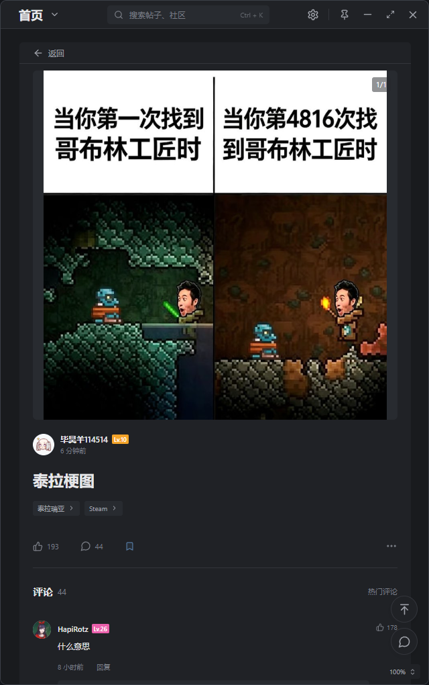
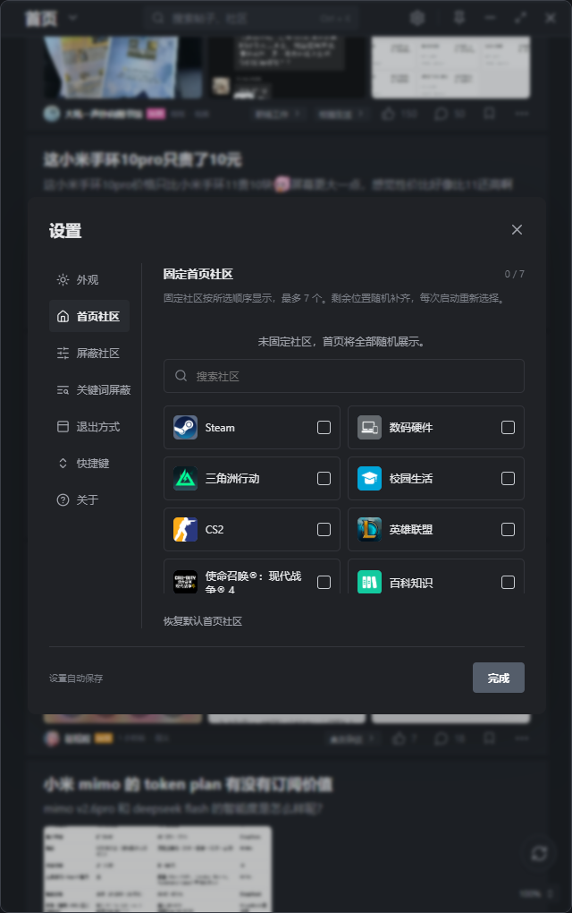

# 小黑盒盒

Windows 第三方社区客户端，采用 Tauri 2、React、TypeScript、Rust 和 SQLite。仅支持小黑盒 App 扫码登录，没有密码、短信登录或发布文章入口。

## 下载与更新

在 [下载与更新页](https://cjbtj.xyz/xiaoheihehe/) 获取最新 Windows x64 安装包。0.1.1 起可通过“设置 → 关于 → 检查更新”查看新版本并下载安装包；下载后退出程序，再运行安装包完成更新。

本次版本改动见 [更新日志](CHANGELOG.md)，发布流程与服务器维护见 [更新服务说明](docs/08-更新服务.md)。

## 界面预览

以下截图取自接入现有登录账号的开发预览：窗口 640 × 1020、100% 缩放、深色主题，内容为真实推荐流、帖子与评论；当前账号头像已隐藏。

**首页 · 深色主题**

紧凑的推荐列表，作者信息与社区、互动操作在底部横向排列。


**帖子详情**

完整配图、吸顶返回按钮，以及右下角的回到顶部和跳转评论入口。



**评论区**

显示置顶角标、作者标识、等级、徽章、官方表情与评论图片。


**首页社区设置**

支持固定社区、调整顺序；剩余位置每次启动随机补齐。



## 运行桌面端

双击项目根目录的 **`启动开发版.cmd`**。脚本会检查开发环境，首次运行自动安装前端依赖，然后启动带真实 Rust 后端的桌面开发版；已运行的本项目网页预览会自动复用。启动失败时窗口保留错误提示。

保留启动窗口，前端修改会自动刷新，Rust 修改会自动编译重启。在启动窗口按 `Ctrl+C` 停止开发进程。开发启动不会生成安装包。

安装 Node.js、Rust stable MSVC、Visual Studio Build Tools（C++ 编译工具及 Windows SDK）和 WebView2 Runtime 后：

```powershell
npm install
npm run desktop
```

桌面端通过 Tauri 直接调用 Rust，不需要启动独立后台服务。窗口无原生标题栏，禁止拖拽调整尺寸，设置支持 50–300% 缩放；滑动条停止操作 300 毫秒后应用，预设比例立即生效；超过屏幕可用尺寸时自动适配。

## 浏览器开发预览

在两个终端分别运行：

```powershell
npm run backend
```

```powershell
npm run dev
```

打开 http://127.0.0.1:5173/。预览与桌面使用同一个 Rust 后端；开发服务仅监听 127.0.0.1:38741，并校验来源、请求头和允许的命令。浏览器里的窗口按钮仍是演示效果。

## 检查与打包

```powershell
npm run build
npm run backend:test
npm run desktop:check
npm run desktop:test
npm run desktop:build
```

Windows 构建脚本自动寻找 MSVC 和 SDK，避免误用 Git 的同名链接工具。安装包生成于 `target/release/bundle/nsis/`。程序依赖系统 WebView2；缺少时由安装器下载运行时。

发布程序为 `target/release/小黑盒盒.exe`，安装包为 `target/release/bundle/nsis/小黑盒盒_0.1.4_x64-setup.exe`。用户修改后的图标位于 `public/branding/heybox-icon.png`，用于网页、关于页、Windows 程序和托盘；修改它后需要重新生成 `src-tauri/icons/` 中的 Windows 图标再打包。

安装器同时部署独立的 `shortcut-icon-rounded.ico`，桌面和开始菜单快捷方式使用该文件。安装或升级时保留快捷方式原有属性并通知 Windows 刷新图标；交互安装结束时再次处理，以覆盖完成页新建的桌面快捷方式。

首次安装默认位置为 `D:\Apps\HeyboxCommunity`；D 盘不可用时采用当前用户目录。可在安装界面修改位置，升级保留原安装目录。

## 当前功能

首次运行采用当前项目预设：跟随系统主题、100% 缩放、窗口基础宽 640px／高 1020px、隐藏右侧栏，开启动画和快捷键，关闭窗口时退出。首页默认不固定社区，7 个位置每次启动随机补齐；社区与关键词屏蔽名单默认为空。已有的本地设置优先使用，不会被预设覆盖。

- 真实推荐流、社区目录与在线社区搜索、帖子搜索，接近列表底部自动加载下一页；失败可重试。
- 社区图标优先使用官方 `small_pic_url`，缺少时使用 `pic_url`；合并帖子和搜索结果补全缺图，加载失败显示社区首字占位。
- 首页社区栏右侧可打开调整入口，也可进入“设置 → 首页社区”：支持搜索添加、移除、调整顺序，最多 7 个，自动保存并可恢复默认。固定社区不足 7 个时随机补齐，随机项本次使用期间保持稳定，每次启动重新抽取。
- 首页右下角悬浮按钮刷新推荐，返回列表顶部并保留屏蔽社区；顶部菜单栏高度为 42 像素。
- 帖子详情返回按钮吸顶，滚动正文和评论时仍可返回；跳转评论区会避开顶部返回栏。
- 从帖子详情返回原列表时恢复进入前的滚动位置，已加载分页保留；刷新推荐或切换列表条件时从顶部开始。
- 帖子评论接近底部自动加载下一页，保留已加载内容并按 ID 去重；失败停止自动请求，点击重试继续失败页，返回或切换帖子后忽略旧请求结果。
- 评论与子回复中的图片按上游 `imgs` 显示为缩略图，点击用同一图片查看器查看大图；加载失败显示占位并可重试，没有图片的评论不占额外空间。
- “设置 → 关键词屏蔽”支持每行一个关键词批量添加、移除和清空，自动保存。仅按首页帖子标题和列表摘要进行文字包含匹配，英文不区分大小写；收藏、浏览记录、盒友主页、详情正文和评论不参与屏蔽，全部命中的页仍继续自动翻页。
- 首页移除推荐／关注／最新／热帖与筛选菜单行，直接展示推荐流。“设置 → 屏蔽社区”支持搜索、多选、取消及清空屏蔽名单，自动保存；按真实 `topics[]` 屏蔽任一分区命中的帖子，保留未分类内容。
- 作者头像、等级、佩戴徽章；盒友主页显示个人简介和发布内容，支持分页及打开帖子后返回主页。
- 列表作者、帖子详情作者、主评论和子评论均可进入盒友主页。
- 扫码、轮询、过期刷新、取消扫码、退出本地登录。
- 登录账号自动补全头像并保存，右上角用户按钮和账号面板显示头像。
- 帖子详情、评论分页及回复、点赞，依赖上游登录和风控许可。
- 官方 CUBE 与黑盒娘表情显示，覆盖摘要、正文、评论及子回复；评论输入框支持选择表情并在光标处插入。
- 点击帖子卡片空白区域也可进入详情；图片预览、作者资料、社区分区及互动按钮保持各自操作。
- 本地收藏、浏览记录、主题、窗口缩放和托盘退出设置。
- “设置 → 关于”展示 GitHub 项目源码地址和 B 站「超级本推荐」主页，点击后使用系统浏览器打开。
- “设置 → 外观”支持调整窗口高度，范围 480–1200px，默认 1020px；滑动防抖、常用高度预设，自动保存并在重启后恢复，超出屏幕时适配。
- 同一设置页支持独立调整窗口宽度（600–1600px），默认 640px，防抖保存并在重启后恢复；自定义宽度不受右侧栏切换影响，可恢复项目默认宽度。
- 设置中的搜索、打开设置、返回、关闭弹窗快捷键可点击录入新组合，自动保存；支持冲突提示、取消录入和恢复默认。返回与关闭弹窗允许共用按键，默认均为 Esc，有弹窗时优先关闭弹窗。
- 右侧“我的社区”栏默认隐藏，外观设置可开启，选择自动保存。默认窗口基础宽高为 640 × 1020，按 100% 缩放，超出屏幕时等比例适配；宽高均可单独调整。

首页使用推荐流。收藏目前保存到本机，不与官方收藏同步。

上游返回 `show_captcha` 时提示前往官方页面；完成浏览器验证不保证桌面会话获得同样的风控许可。不会自动绕过验证码或伪造登录成功。登录后接口和写入操作需要实际账号验证，自动检查不会向社区提交评论或点赞。

## 数据保存

开发模式保存于项目 `data/`。发布版优先保存于应用所在目录的 `data/`，无写权限时使用 `%LOCALAPPDATA%/HeyboxCommunity/data/`。设置、筛选、本地收藏和浏览记录在 SQLite 中；凭据由 Windows DPAPI 加密，绑定当前 Windows 用户，不传到前端。

`data/`、编译产物和接口调研原始资料均忽略提交。请勿提交登录凭据或携带二维码会话的截图。

## 代码

| 路径 | 用途 |
| --- | --- |
| `backend/src/` | 签名、请求、响应归一化、过滤、扫码与本地保存 |
| `src-tauri/` | 桌面命令、窗口、托盘、安装配置 |
| `src/api.ts` | 桌面调用与浏览器预览适配 |
| `src/useBackend.ts` | 本地状态保存、请求取消、分页 |
| `src/Online.tsx` | 扫码、头像徽章、错误状态 |
| `src/UserHome.tsx` | 盒友个人资料、发布内容与分页 |
| `src/AboutPanel.tsx` | 关于页、项目源码和作者主页链接 |
| `docs/` | 原始接口调研与实现说明 |

接口事实参考官方网页和本项目调研，签名实现使用独立代码及调研回归向量。`research/xhh-workshop` 是 GPL-3.0 项目研究副本，未作为运行依赖或直接复制进后端。项目与小黑盒官方无关联。
