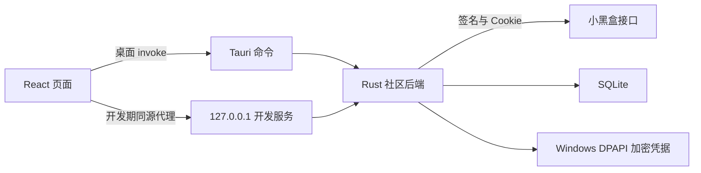

# 后端实现与边界

## 调用关系

生产桌面程序不会启动开发 HTTP 服务。前端只能调用明确枚举的业务命令，不能指定任意接口路径、凭据或本地文件路径。

## 网络与数据

每次请求新建签名，设备 ID 持久保存。请求带官方网页来源头，Cookie 由 Rust 管理；HTTP 成功后继续检查 `status`。网络连接超时 8 秒，总超时 20 秒，全局请求间隔至少 300 毫秒。写入失败不自动重试，避免重复评论。

推荐流按 offset 每页 30 前进。社区流分别保存 offset，每次最多读取 6 个社区、并行最多 4 个，轮换覆盖全部选中社区。服务端条数不固定，只依据实际空页停止；筛选后空页仍可继续读取。普通流单次最多补取 3 页。前后端按帖子 ID 去重。

分区只来自 `topics[]`，不使用文章／视频类型或 hashtag 代替分区。任一分区被屏蔽则隐藏；只看模式至少命中一个选中分区；无分区不构成只看匹配。广告和无帖子 ID 数据丢弃。

HTML 正文转换为文本，不把上游 HTML 直接注入桌面页面。图片及视频地址仅接受 HTTPS。浏览器开发服务校验固定 Origin、Host 和自定义头，不开放跨域调用；请求体上限 128 KiB。

## 扫码

1. 后端请求官方二维码，生成 SVG，返回不可猜测的本地会话 ID 和过期时间。
2. 前端每 3 秒查询状态，后端限制至少间隔 2 秒。官方 `wait` 为等待扫码，`ready` 为已扫码待确认，两者都会继续轮询。
3. 每个二维码使用独立临时 Cookie 容器；按 `/account/qr_state/` 路径读取 Cookie，成功需同时取得用户 ID 和 `user_pkey`。扫码请求指定 `app=web`，覆盖公共参数且不重复传入。
4. 取消或过期会话不能安装凭据；关闭弹窗停止轮询并取消会话。
5. 成功凭据由 DPAPI 加密保存；前端只得到公开账号摘要。
6. 退出删除加密文件和本地会话 Cookie，取消扫码，清除账号缓存状态，保留本机收藏及公共帖子快照。

没有密码登录、短信登录或凭据导入入口。验证码、token 失效及未知扫码状态均明确显示，不作为登录成功。

## 本地数据

SQLite 使用 WAL 和 FULL 同步；本地设置按允许的键与类型保存。浏览记录最多 100 条；缓存保留最近 1500 个帖子并额外保留已收藏的帖子。恢复收藏和浏览记录使用缓存快照，不依赖当前信息流是否包含该帖子。

凭据与数据库存储在同一数据目录，凭据独立加密。开发目录为 `data/`，发布时优先安装位置、其次当前用户 LocalAppData。

## 验证范围

回归检查覆盖接口签名、广告剔除、图片地址检查、等级和徽章字段、跨分区过滤、未分类行为、HTML 活动内容移除、SQLite 跨进程恢复、DPAPI 加密解密、业务错误和命令限制。

已使用现有扫码账号验证最近浏览帖子的正文图片、主评论、评论第二页、楼中楼预览与子回复读取；在线互动操作尚未端到端验证。上游风控可能独立限制接口，匿名样本不能证明登录后的行为。自动验证只读取内容和创建／取消二维码，不提交评论、点赞、关注或官方收藏。

### 2026-10-10 实测

- `npm run build`、`npm run backend:test`（8 项）、`npm run desktop:check`、`npm run desktop:build` 通过。
- 当前社区目录返回 74 个社区；推荐流首页返回 10 个帖子，offset 前进到 30，继续加载达到 20 个帖子。
- Steam 和 CS2 合并筛选返回 39 个帖子，界面归属检查通过；屏蔽 CS2 和盒友杂谈返回 14 个帖子，无分区泄漏。
- 社区在线搜索“艾尔登”返回 20 个匹配项。帖子搜索在本次请求中返回 `show_captcha`，界面按风控状态处理。
- 浏览器验证本地收藏快照、重载恢复、多社区筛选、分页、二维码生成、轮询、关闭取消，无页面异常。
- Windows 发布版通过真实 Tauri IPC 读取 10 个帖子，125% 缩放得到 1200×950；扫码生成与轮询正常，无页面异常。
- 非允许来源调用开发服务返回 403。匿名详情返回 `show_captcha`，未提交任何在线互动。
- 程序正式命名为“小黑盒盒”，接入用户修改后的图标。安装器 `小黑盒盒_0.1.0_x64-setup.exe` 成功生成，大小约 3.04 MiB；主程序 `小黑盒盒.exe` 约 9.9 MiB，不含系统 WebView2 Runtime。安装器目录选择页优先使用 `D:\Apps\HeyboxCommunity`，现有安装位置和用户修改的位置保留。

发布程序使用本机 WebView2。调试时为桌面检查临时启用了调试端口，验证完成后已关闭该测试进程；正式启动不添加调试参数。

### 扫码确认后无法登录的修复

原实现没有识别官方 `result.error = "ready"`，把已扫码状态当作错误返回，导致前端在手机确认前停止轮询。另一个可复现的问题是按站点根路径读取 Cookie 时会遗漏限定到 `/account/` 或轮询路径的登录 Cookie。两项回归测试均先复现失败，再验证修正后通过；后端共 10 项测试通过。

`scripts/check-qr-login.cjs` 使用模拟响应验证等待扫码 → 已扫码 → 登录成功，关闭弹窗再次打开和刷新页面后仍显示账号。用户随后确认真实扫码登录成功。开发期没有生成新安装包。

### 登录账号头像补全

扫码成功时原实现把 `avatarUrl` 固定为空，且恢复账号时没有获取个人资料。现在优先保留扫码响应的头像；账号初始化发现头像缺失时，读取本人资料并更新昵称、头像及等级，将公开账号摘要写回原来的 DPAPI 加密文件，保留登录凭据。资料暂时不可用时保留已有账号摘要；退出与资料补全串行执行。

现有登录无需退出即可补全。右上角用户按钮和账号面板均使用头像，图片请求不发送 Referer。真实账号检查先复现“资料有头像但登录摘要无头像”，修复后确认头像图片读取成功、账号摘要补全并可恢复；检查仅输出布尔结果，不输出账号或凭据。后端 12 项测试、前端构建、桌面编译检查和模拟头像显示检查通过。

已有扫码登录时，可手动运行 `powershell -NoProfile -ExecutionPolicy Bypass -File scripts/native.ps1 AvatarCheck` 检查本人头像获取与本地恢复；这项检查不加入自动测试，也不执行社区互动。

### 一键启动误报预览服务未就绪

Vite 热更新后会把入口改为 `/src/main.tsx?t=时间戳`，原启动脚本只接受没有查询参数的入口，因此对正常返回 HTTP 200 的预览服务误报未就绪。校验现已接受入口的可选查询参数，仍检查占用端口的进程属于本项目。使用 Windows PowerShell 的 `-CheckOnly` 检查通过，并通过 `启动开发版.cmd` 实际启动了响应正常的“小黑盒盒”桌面窗口。

### 信息流导航调整

首页列表接近底部 240 像素时通过 IntersectionObserver 自动加载下一页，沿用请求互斥和分页游标。加载中、分页结束、请求失败或打开弹窗时暂停自动加载；失败后的重试继续请求失败页，不清空已加载帖子。空页仍有后续游标时继续读取，不提前显示列表结束。

右下角新增刷新推荐按钮，位于缩放控件上方。点击后回到推荐流顶部、清除当前单社区及搜索条件、保留多社区筛选并重新读取第一页。顶部标题栏从 62 改为 42 像素，搜索框和页面菜单跟随调整。

`scripts/check-feed-navigation.cjs` 使用模拟分页验证滚动加载、重复请求保护、分页结束、失败暂停和原游标重试、刷新重置、保留筛选及悬浮控件边界；前端构建通过。开发期未生成安装包。

### 详情图片与评论解析修复

最近浏览的两篇帖子详情请求成功且有后续评论，但旧解析器得到零条评论、零张正文图片。实际 `link.text` 是 JSON 编码的文字和图片分块数组，评论楼层的 `comment` 也是数组。现在提取正文文字与图片并去重，兼容 HTML 正文；每层取数组首项作为主评论，避免将回复预览重复列为主楼层。图片预览统一使用 `no-referrer`。

修复后两篇帖子均返回 2 张正文图片、首批 20 条主评论，4 个图片请求均为 HTTP 200 / image/jpeg；第二页评论请求成功。这次复现属于解析错误，没有返回风控错误。新增三项回归测试覆盖正文分块、楼层数组、图片去重与活动地址剔除，后端共 15 项测试通过。

已登录且有浏览记录时，可手动运行 `powershell -NoProfile -ExecutionPolicy Bypass -File scripts/native.ps1 ContentCheck`，只读取最近两篇帖子和图片，输出状态及数量，不输出凭据或正文内容。

### 2026-10-11 帖子快捷导航

列表进入详情前保存当前滚动位置及页面／社区／搜索／筛选上下文。原来监听 `selected.id` 的统一归零逻辑会在返回时也归零，现改用布局阶段区分进入、返回和条件变化：进入详情归零，返回相同列表恢复原位置，刷新或切换条件清除旧位置。本地列表仍在加载时等待内容就绪再恢复。返回按钮和 Esc 共用同一恢复过程。`scripts/check-feed-navigation.cjs` 验证第二页帖子进入详情、滚动评论后通过按钮／Esc 返回的位置与进入前一致，已加载 16 条帖子保留且不重新请求推荐；刷新、社区切换及自动分页检查也通过。前端构建通过，未打包。

帖子详情右下角新增“回到顶部”和“跳到评论区”两个悬浮按钮，放在缩放控件上方，返回列表后隐藏。跳转按当前界面缩放换算滚动距离；关闭动画或系统要求减少动态效果时即时跳转。

`scripts/check-detail-content.cjs` 使用模拟内容验证正文图片、大图预览、评论分页，以及 50%、100%、150%、300% 网页预览缩放下的顶部与评论跳转、控件无重叠。前端构建与桌面编译检查通过；未生成安装包。

### 盒友主页入口

原入口只打开账号摘要弹窗，部分帖子仅在 `user.userid` 携带作者 ID，旧解析器漏读后直接退出点击处理。现兼容顶层及嵌套作者 ID，旧缓存没有作者 ID 时先获取详情补全。帖子列表、详情头像与名称、主评论头像与名称、子评论名称均可进入“盒友主页”。

主页读取 `/bbs/app/profile/user/profile` 个人资料与 `/bbs/app/profile/events` 发布内容，展示头像、等级、签名、帖子摘要和图片。发布内容沿用上游字符串 `lastval` 游标，支持继续加载、失败保留游标重试和去重；点击内容打开详情，可返回盒友主页。用户主页关闭或切换时忽略旧请求结果。没有添加关注或其他在线写操作。

手动运行 `powershell -NoProfile -ExecutionPolicy Bypass -File scripts/native.ps1 UserHomeCheck` 可只读验证最近浏览帖子的作者主页。真实账号实测资料包含昵称和头像，发布内容首页得到 4 条，第二页为空并结束。`scripts/check-user-home.cjs` 验证旧缓存入口补全、资料和内容、游标重试、去重、详情往返及主／子评论入口。后端 17 项测试与桌面编译检查通过；开发期未打包。

### 官方表情适配

读取 `/bbs/app/api/emojis/list`，按官方 `group_code` 与 `code` 构造 `[cube_哭泣]` 等标记，使用 `img` 图片地址。内联表情只纳入 type 1、3，不把 type 2 贴纸混进普通表情目录。目录缓存 24 小时，网络失败可恢复旧缓存；前端全局共享一次请求。

信息流标题和摘要、详情标题及正文、主评论、子评论、盒友主页的发布内容均使用文本片段与图片渲染。未知标记或图片失败保留原标记，不把正文解析为 HTML。评论输入框新增分组表情面板，按当前光标／选区插入官方标记，发送时保持原标记，仍限制 5000 字符。

实测目录为 129 个表情；哭泣、喜欢、无语图片均返回 HTTP 200 / image/png，跨后端实例的目录缓存恢复通过。`scripts/check-emojis.cjs` 模拟验证显示范围、未知与失败回退、文本安全、分组切换、光标插入和发送标记（未提交真实评论）。后端 18 项测试、桌面编译检查通过。可使用 `powershell -NoProfile -ExecutionPolicy Bypass -File scripts/native.ps1 EmojiCheck` 执行只读检查，开发期未打包。

### 首页关键词屏蔽

设置增加独立的“关键词屏蔽”页，批量输入每行一个词，去除首尾空白并按不区分大小写去重，支持删除单项及清空，最多 128 项、每项 100 个 Unicode 字符。新增 `heybox.blocked-keywords` 状态键（总计 6 个允许键），由 SQLite 保存，兼容旧数据的空名单，关闭窗口时同步提交，后端校验数量、长度、非空、规范空白、换行和唯一性。

屏蔽在前端首页列表阶段生效，只分别匹配 `post.title` 和 `post.excerpt` 的文字包含关系，不合并跨字段、不使用正则、不扫描正文、评论、作者或社区名称。收藏、记录及盒友主页保持可访问；词表不传给上游请求，不修改帖子缓存和已有分页，整页被屏蔽时继续原有自动翻页。名单修改后首页回到顶部，其他列表滚动不受影响。

`scripts/check-blocked-keywords.cjs` 模拟验证标题／摘要匹配、大小写、字面符号、跨字段不命中、批量去重、空值与长度限制、自动保存、重载、移除清空、各页面作用范围及全部屏蔽页自动继续；前端构建、后端 24 项测试与桌面编译检查通过。新增后端状态键，需要重新启动开发版以加载更新的 Rust 进程，未打包。

### 评论自动分页

详情评论区删除“加载更多评论”按钮，使用滚动容器内的 IntersectionObserver，在距列表尾部 180px 时加载下一页。同步请求引用防止重复调用，第一页刷新可取消旧请求；分页成功后按评论 ID 去重追加，空页仍有下一页时继续推进。请求失败保留评论与当前成功页，在列表末尾显示重试并重新请求失败页，停止自动重试。切换或离开帖子时取消浏览器请求，原生 IPC 即使不能中止也会通过控制器状态及请求身份丢弃旧结果；弹窗、图片预览、盒友主页、发送评论及窗口收起时暂停自动分页。

`scripts/check-comment-pagination.cjs` 模拟验证接近底部触发、重复保护、错误保留、失败页重试、重复评论去重、空页推进、末页停止及切换帖子忽略迟到响应；详情图片与导航检查同时通过（50／100／150／300% 缩放）。前端构建通过，未打包。

### 首页菜单与屏蔽社区

标题栏拖动不再要求事件目标恰好为 header：主鼠标键点击首页右侧容器空白、标题栏间隙及非交互子元素会调用桌面 `window_action("drag")`；按钮及其图标、搜索框全区域、下拉菜单及其留白排除，操作失败显示提示。`scripts/check-titlebar-drag.cjs` 在浏览器中模拟桌面 IPC，先复现首页右侧空白不触发拖动，修复后验证空白、子元素、左键限制和搜索／菜单／窗口按钮正常交互；构建通过。该检查验证事件与调用路径，未实测 Windows 原生窗口位移；未打包。

首页删除推荐／关注／最新／热帖及社区筛选整排菜单，固定使用推荐流；收藏与记录页保留标题。侧栏顶部同步取消原菜单行占位。筛选界面整合到设置的“屏蔽社区”页，仅保留多选屏蔽、在线搜索、单项取消及清空，自动保存，没有只看模式或未分类开关；无分区帖子保留。旧 exclude 名单迁移保留，旧 include／all 不启用其闲置的 exclude 名单，移除旧只看与隐藏未分类条件。后端旧结构仍兼容，前端请求始终为 exclude、included 为空、unknown 为 true。

`scripts/check-blocked-communities.cjs` 使用模拟数据验证菜单移除、旧配置迁移、多分区命中、搜索多选、未知社区取消、自动保存、刷新和重载、清空以及收藏页标题；`scripts/check-feed-navigation.cjs` 回归验证自动分页、刷新与返回滚动位置。前端构建通过，未打包。

### 可调窗口尺寸

外观设置同时支持独立调整窗口宽度（600–1600，步长 20）。`windowWidth` 为可选整数；未设置时仍随侧栏采用 720／960，恢复默认删除该属性。自定义宽度不受侧栏切换影响，采用 300ms 防抖、关闭时提交待保存值；最大化时保存供还原后使用，缩放与屏幕适配同时使用用户宽高。最小物理宽度降为 300，以支持 600 与 50% 缩放。`scripts/check-window-width.cjs` 模拟验证防抖、宽高独立、侧栏切换、缩放、重载、预设覆盖、默认恢复和屏幕适配；构建、后端 23 项测试与桌面 3 项尺寸测试通过，未打包。

外观设置新增窗口高度滑块（480–1200，步长 20），首次运行默认 1020，提供 600／760／900／1020／1080／1200 预设。调整采用 300ms 防抖，预设可覆盖待提交滑块值，关闭窗口时提交未完成的高度调整；`heybox.preferences.windowHeight` 可选，旧设置未指定高度时沿用 760。高度跟随缩放，最大化时保存设置供还原后使用，超出屏幕按比例适配。

项目默认设置集中于 `src/settingsDefaults.ts`，采用现有账号的设置快照：跟随系统主题、缩放 125%、基础宽 600／高 1020、隐藏右侧栏，动画与快捷键开启，关闭窗口退出。首页固定 Steam、CS2、火影忍者，剩余位置保持每次启动随机补齐；屏蔽名单为空。不包含账号凭据、收藏或浏览记录。已有本地设置优先，恢复默认宽度和首页社区使用项目预设；缩放滑块步长为 5，可准确显示 125%。已验证首次初始化、随机补齐、恢复默认和已保存设置优先。

关于页提供 GitHub 项目源码和 B 站「超级本推荐」主页链接。桌面打开外部页面时，除原有官方社区地址外，仅允许这两个指定地址；打开失败会显示提示。桌面测试 4 项通过，浏览器检查确认链接目标正确且卡片无横向溢出。已成功构建 0.1.0 Windows x64 NSIS 安装包，约 3.07 MiB。

前端预览和桌面 `window_action` 使用同一基础高度；桌面尺寸计算由固定 760 改为高度参数，并校验范围。最小物理高度由 380 调为 240，以支持最低高度 480 与 50% 缩放。`scripts/check-window-height.cjs` 模拟验证防抖、预设、尺寸、缩放兼容、重载保存和屏幕适配；前端构建、后端 22 项测试及桌面 2 项尺寸测试通过。桌面测试验证尺寸计算和编译，不等同于实际 Windows 窗口交互矩阵；未打包。

### 自定义快捷键

设置 → 快捷键支持修改搜索、打开设置、返回和关闭弹窗四项。点击快捷键按钮后录入 Ctrl／Alt 组合或功能键，阻止冲突组合及常见窗口／浏览器／输入法保留组合。返回与关闭弹窗允许共用按键，默认均为 Esc；录入这两项时 Esc 会保存，其他两项录入时 Esc 取消。录入中也可点击“取消录入”。有弹窗时同一按键只关闭最上层弹窗，下一次再返回帖子列表。Esc 仍作为弹窗关闭备用键，输入框内停用搜索／设置／返回快捷键。可关闭快捷键或一键恢复默认。

按 `KeyboardEvent.code` 和 Ctrl／Alt／Shift 的完整组合匹配，不让额外修饰键误触发。偏好新增可选 `keybindings`，旧设置仍使用默认组合；后端校验四项名称、按键、布尔修饰键和重复组合，仅返回与关闭弹窗允许重复。搜索框旁提示随设置更新。`scripts/check-shortcuts.cjs` 模拟验证录入、冲突提示、取消、保存后重载恢复、四项动作、输入时停用、总开关和恢复默认，补充两个 Esc 默认值及共用自定义组合时弹窗优先的验证。前端构建、后端 20 项测试通过，开发期未打包。

### 社区图标一致性

首页社区从固定目录前七项改为可配置快捷入口。社区栏右侧按钮打开“设置 → 首页社区”，支持最多七项、移除、前移／后移、目录选择与在线搜索添加，立即更新并自动保存。`heybox.home-communities` 保存有序固定社区摘要；`null` 表示跟随默认目录，空数组表示全部随机。保存名称与图标可在重启后展示搜索添加但不在基础目录中的社区，目录有新数据时优先使用新名称及图标。社区筛选和右侧栏独立。

固定社区不足七项时，使用本次启动首次成功读取的官方目录补齐随机社区，排除重复与固定项。启动时生成一次随机种子，刷新内容、进入／退出设置和信息流新增分区均不会重新抽取；重启产生新种子。设置仅编辑和保存固定项，随机项不被写入固定配置；目录不足时展示现有可用项。`scripts/check-home-random.cjs` 验证固定顺序、唯一补齐、会话稳定、新启动重新选择、固定配置不混入随机项、全部随机、目录不足与重复处理。前端构建通过，未打包。

后端新增状态键及结构、数量、重复 ID、图片地址校验，关闭窗口时也保存该状态。`scripts/check-home-communities.cjs` 模拟验证增删、排序、七项限制、搜索添加、保存后重载、恢复默认与筛选不变；图标回归检查、前端构建、后端 21 项测试和桌面编译检查通过，未生成安装包。

社区目录来自 `/bbs/app/topic/categories`，搜索来自 `/bbs/app/api/post_editor/topic_selection/search`，帖子分区也能补充社区节点。旧模型只取 `pic_url`，而官网目录使用 `small_pic_url`；实测 CS2、三角洲行动、数码硬件等两字段内容不同，三角洲行动的 `pic_url` 是游戏封面。

现优先读取有效的 `small_pic_url`，缺少时回退 `pic_url`。相同 `topic_id` 的后续节点可以补全缺图或用小图替换封面，忽略无名称的菜单节点。前端目录优先，合并帖子／搜索结果时补全空图，保留已有社区；三个社区图标位置共用图片失败占位。目录缓存改用 `communities-icons-v3`，避免恢复旧字段选择结果。

`CommunityIconCheck` 只读实测得到 74 个社区、0 个空地址，抽查前 7 个图标均返回 HTTP 200 与图片类型；这不保证所有 CDN 地址始终可用。`scripts/check-community-icons.cjs` 模拟验证目录晚到时替换帖子封面并保留补图、重复节点补图、搜索补图以及空地址／404 的占位显示。前端构建、后端 19 项测试和桌面编译检查通过，未生成安装包。

### 评论置顶、等级与子回复

评论模型此前只保留文本和头像，遗漏了用户等级及每层主评论之后的子回复数组。现保留 `user.level_info.level`、徽章、`is_link_owner` 作者标记、`top_comment` 置顶标记、`child_num` 回复数量和 `has_more` 后续回复标记。`is_top` 属于热门评论，不能据此显示置顶。

页面默认显示两条回复预览，支持全部回复、继续分页、收起以及回复具体子评论。子回复接口返回的 `lastval` 作为下一页游标，并补全所属根楼层；失败重试保留原游标和已加载内容，关闭帖子后不安装旧请求结果。`ContentCheck` 现在也只读检查回复预览、等级、置顶数量、子回复读取和游标前进。

置顶标记按官方参考图改为评论左上角的 32 像素黑色三角，白色“置顶”斜排；头像向右留出空间，避免与角标重叠。前端构建及评论页面检查通过。

真实读取确认最近两篇帖子主评论均有等级，并获得 5 条／11 条预览、后续 9 条／7 条子回复；实际接口样本也确认置顶评论有 `top_comment = 1`。`scripts/check-comment-threads.cjs` 模拟检查置顶与等级显示、展开／收起、去重、分页结束、失败后保留游标重试，以及发送子回复时关联根楼层（只拦截本地模拟请求）。后端 16 项测试、前端构建和桌面编译检查通过，未生成安装包。

### 桌面布局裁切修复

桌面端 `.native-desktop` 与后面的 `.desktop-stage` 优先级相同，网页预览的 `padding: 32px 24px` 覆盖了桌面零边距。真实桌面在 125% 下测得窗口起点 `(24, 32)`、关闭按钮右边界 `1212.75`，超过 1200 像素视口；状态栏下边界 982，超过 950 像素视口。

改为 `.desktop-stage.native-desktop` 后，真实桌面临时应用该修正的边界检查通过：窗口起点为 `(0, 0)`、关闭按钮和状态栏完全位于视口内。回归脚本保存在 `scripts/check-desktop-layout.cjs`。浏览器中按桌面尺寸与变换模拟 50%、100%、125%、300%，全部无页面溢出；这些模拟不等同于原生窗口缩放验证。

新版前端与安装器构建通过，但自动审批以“策略阻止”拒绝启动新版测试副本及普通启动，未完成新版程序的原生缩放矩阵检查。旧复现进程已通过应用自身退出命令关闭，调试端口已关闭。同时排除开发工具对 `output/` 的监听，避免测试 WebView 数据文件被占用时使预览服务退出。
